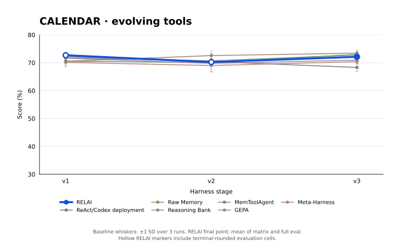
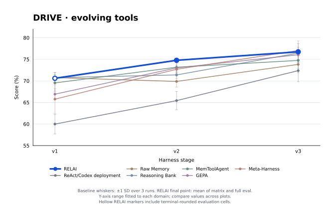
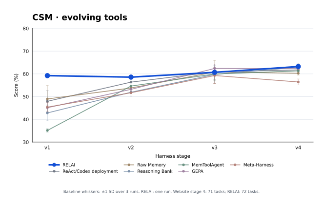
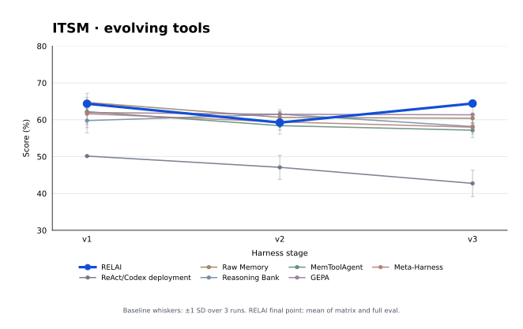

# RELAI on EvoHarnessBench's evolving tools

This repository records four local **self-evolving** experiments on the EnterpriseOps-Gym (EOG) tools track of [EvoHarnessBench](https://mas-orchestra.salesforceresearch.ai/evoharness/). A GPT-5 ReAct agent adapted its code with RELAI as each domain's tool pool grew. The four selected runs cover calendar, drive, customer service management (CSM), and IT service management (ITSM). Each domain was run once; the baseline figures below are extracted from the EvoHarnessBench team's published multi-run results for context.

## Results

**Score** is a task's fraction of verifiers passed, averaged over tasks. It gives partial credit and is distinct from strict pass rate, which requires every verifier to pass. Each “stage” value below weights the matrix cells at that harness stage by their test-task counts. The separate “final full eval” is a fresh evaluation of the final agent on all test cohorts with the final tool pool; it need not equal the weighted final-stage matrix value. All values are percentages. Run IDs link to the copied source reports.

| Domain | RELAI stage 1 | Stage 2 | Stage 3 | Stage 4 | Final full eval | Final test tasks | Run |
| --- | ---: | ---: | ---: | ---: | ---: | ---: | --- |
| Calendar | 72.70 | 70.25 | 71.41 | — | 72.85 | 43 | [`20261002T195831Z-59fddc8d`](artifacts/calendar/run/recovery/report.json) |
| Drive | 70.60 | 74.77 | 76.48 | — | 77.00 | 45 | [`20261007T124934Z-54148b3e`](artifacts/drive/run/report.json) |
| CSM | 59.23 | 58.57 | 60.69 | 63.24 | 64.42 | 72 | [`20261012T154955Z-95d47fda`](artifacts/csm/run/report.json) |
| ITSM | 64.35 | 59.23 | 67.64 | — | 61.18 | 73 | [`20261019T013854Z-06abfff3`](artifacts/itsm/run/report.json) |

Values above are rounded only after aggregation. The exact saved figures explain small differences from the original notes: Calendar's recovered full evaluation is 72.8516%, while ITSM's weighted stage 3 score is 67.6392%. Calendar's first two stage scores and Drive's first stage score depend partly or wholly on terminal-rounded cells, so extra digits in their weighted aggregates do not imply extra measurement precision.

## Stage-score plots

These plots compare RELAI with the six cumulative EOG tool systems for which the [EvoHarnessBench results](https://mas-orchestra.salesforceresearch.ai/evoharness/#results) publish per-domain, per-stage scores. The blue RELAI line is one local run; each other line is the website mean of three runs, with whiskers showing ±1 population standard deviation. Earlier RELAI points use the weighted matrix scores in the table. Its **final point is the arithmetic mean of the unrounded final-stage weighted matrix score and the separate final full-evaluation score**: 72.13% for calendar, 76.74% for drive, 63.83% for CSM, and 64.41% for ITSM. The table retains both source scores. Hollow blue markers indicate RELAI stage scores that include terminal-rounded evaluation cells. All plots use the same 30–80% vertical scale.

### Calendar

 [PNG](plots/calendar.png)

### Drive

 [PNG](plots/drive.png)

### CSM

 [PNG](plots/csm.png)

### ITSM

 [PNG](plots/itsm.png)

The website's CSM task counts are 13, 27, 47, and 71 through stages 1–4; this RELAI run's counts are 13, 28, 48, and 72. The CSM lines therefore do not summarize identical test sets from stage 2 onward. The cause of the difference is not established by these artifacts. Counts match in calendar, drive, and ITSM.

## Baseline data

The website's baseline **Score** figures below are means ± population standard deviations over three runs. They were extracted from the site's [published baseline data](https://mas-orchestra.salesforceresearch.ai/evoharness/static/baselines/data.js), snapshot labeled August 2026, into [`baseline_scores.json`](baseline_scores.json). The pinned source SHA-256 is `a1ea84cfbccbedf721acb6e1ef37b2b026361696db477821ef11b6ebf0f81e06`. This repository does not contain their raw runs. The RELAI figures above are single runs, so they have no uncertainty estimate.

| Domain | System | Stage scores (%) |
| --- | --- | --- |
| Calendar | ReAct/Codex deployment | 72.2 ± 0.5, 70.4 ± 1.2, 68.3 ± 1.4 |
| Calendar | Raw Memory | 70.5 ± 1.9, 72.6 ± 1.6, 73.4 ± 1.0 |
| Calendar | Reasoning Bank | 71.7 ± 0.2, 70.7 ± 0.4, 72.8 ± 1.4 |
| Calendar | MemToolAgent | 70.5 ± 1.1, 70.1 ± 3.2, 73.0 ± 0.5 |
| Calendar | GEPA | 71.7 ± 1.3, 69.8 ± 0.8, 71.0 ± 1.3 |
| Calendar | MetaHarness | 70.1 ± 1.5, 69.0 ± 2.4, 70.4 ± 0.9 |
| Drive | ReAct/Codex deployment | 60.0 ± 2.3, 65.4 ± 2.1, 72.4 ± 2.6 |
| Drive | Raw Memory | 70.7 ± 1.2, 69.9 ± 1.3, 73.8 ± 1.9 |
| Drive | Reasoning Bank | 70.8 ± 1.2, 71.4 ± 0.9, 76.5 ± 2.2 |
| Drive | MemToolAgent | 69.5 ± 1.9, 73.2 ± 1.7, 74.7 ± 1.9 |
| Drive | GEPA | 66.9 ± 1.3, 73.0 ± 1.1, 76.1 ± 1.8 |
| Drive | MetaHarness | 65.8 ± 3.3, 72.7 ± 0.9, 77.0 ± 2.2 |
| CSM | ReAct/Codex deployment | 47.9 ± 4.7, 56.4 ± 3.2, 60.9 ± 3.4, 61.8 ± 1.3 |
| CSM | Raw Memory | 49.0 ± 5.9, 53.8 ± 0.2, 60.8 ± 5.1, 60.3 ± 0.8 |
| CSM | Reasoning Bank | 42.8 ± 3.5, 51.9 ± 1.7, 59.8 ± 3.8, 62.9 ± 1.8 |
| CSM | MemToolAgent | 35.1 ± 0.7, 54.7 ± 2.2, 60.0 ± 3.0, 61.3 ± 1.2 |
| CSM | GEPA | 45.1 ± 2.3, 53.2 ± 1.2, 62.4 ± 1.9, 62.3 ± 1.1 |
| CSM | MetaHarness | 45.4 ± 2.0, 51.7 ± 0.4, 59.3 ± 3.5, 56.4 ± 1.3 |
| ITSM | ReAct/Codex deployment | 50.1 ± 0.2, 47.1 ± 3.3, 42.7 ± 3.6 |
| ITSM | Raw Memory | 64.7 ± 2.5, 60.6 ± 1.2, 60.4 ± 1.4 |
| ITSM | Reasoning Bank | 59.8 ± 3.3, 61.5 ± 0.8, 58.2 ± 2.1 |
| ITSM | MemToolAgent | 62.2 ± 0.7, 58.4 ± 1.2, 57.2 ± 2.0 |
| ITSM | GEPA | 62.0 ± 4.1, 61.5 ± 0.7, 61.3 ± 2.8 |
| ITSM | MetaHarness | 61.6 ± 2.8, 59.4 ± 3.4, 58.0 ± 1.3 |

These are useful reference points, but they are not a controlled estimate of RELAI's advantage over another method: the RELAI runs used a local agent implementation, a cumulative task pool for adaptation, and one run per domain. The website results come from the benchmark team's system configurations and three repeats. The CSM task-count difference further limits direct comparison there.

## Experiment setup

The initial agent used `gpt-5`, a 50-step limit, a 16,384-token completion limit, and a 4,000-character tool-result cap. Each adaptation stage gave RELAI all training task IDs seen through that stage; RELAI evaluated those tasks with the **current** stage's accumulated tool pool. It could update the agent code, and its memory carried forward between stages within a run. The saved agent version for each test stage is the `active_commit` in that stage's status file; [`manifest.json`](manifest.json) maps those commits to exported code snapshots and the selected training-task counts. Optimizer rollout budget was 50 per stage for these runs.

The test matrix evaluates cohort *i* with the adapted agent and cumulative tool pool at stage *t* for every *i ≤ t*. For example, Drive stage 3 combines cohort sizes 29, 10, and 6, then computes `(29 × cell₁ + 10 × cell₂ + 6 × cell₃) / 45`. The final full evaluation runs all 45 again, so it is a separate trial. Each report contains the original matrix and before-adapt cells; [`analyze.py`](analyze.py) recomputes the table above.

## Evidence and limitations

Calendar and Drive began before the tool-track runner had robust evaluation checkpointing and resume support. Their early results were captured only as rounded scores printed in the terminal:

- Calendar: matrix cells `(cohort 1, stage 1)`, `(cohort 1, stage 2)`, and `(cohort 2, stage 2)`, plus the stage 2 and 3 before-adapt cells.
- Drive: matrix cell `(cohort 1, stage 1)` and the stage 2 before-adapt cell.

Those cells have no saved per-task grades, verifier outcomes, strict pass rates, or usage. The copied reports mark them `rounded_to_0.001`. Calendar's stage 3 matrix cells and final full evaluation were subsequently run with the preserved stage 3 agent, so their task-level evidence comes from recovery trials. Agent code for **every evaluated stage** remains available and is exported here. Rerunning an early stage would create a new trial; it would not recreate the missing original grades.

CSM and ITSM, and the later Drive and Calendar cells, have per-task grades, verifier outcomes, and complete referenced traces. The archive includes exactly the traces referenced by the selected reports, plus the checkpoint grades for those cells. It does not include raw optimizer event streams, the 50 MB training catalog, or unrelated runs. The source snapshots include the agent and adapter code but not that catalog, so this is a self-contained **results archive**, not a standalone copy of the hosted evaluation service.

The local traces can contain full task prompts, tool inputs and outputs, and simulated business data. Review them before sharing this repository beyond the local workspace.

## Repository layout and verification

```text
artifacts/<domain>/run/                 original report and selected evaluation evidence
artifacts/<domain>/agent_versions/      initial source and each evaluated stage's source
manifest.json                           run IDs, stage commits and evidence inventory
checksums.sha256                        SHA-256 of every imported artifact
analyze.py                              recomputes scores; no external dependencies
import_runs.py                          regenerates this archive from local source runs
baseline_scores.json                    pinned website baseline summary
refresh_baselines.py                    fetches and verifies that website source
plot_results.py                         regenerates four domain plots
plots/<domain>.svg, .png                rendered comparison figures
pyproject.toml, uv.lock                 locked matplotlib plotting dependency
```

Recompute the RELAI results and validate all imported grades, trace links, and checksums:

```sh
python3 analyze.py --check
```

Regenerate the figures from the copied results and pinned baseline summary with `uv run --locked python plot_results.py`. To compare the website source with the pinned snapshot, run `python3 refresh_baselines.py --check` (requires network access). A changed upstream source hash requires an explicit review before updating the local summary.

If the original tool-track checkout and runs are available, regenerate the imported artifacts with:

```sh
python3 import_runs.py --tool-track ../tool-track
```

The import script requires no API keys or hosted service calls. It exports stage source from the exact Git commits recorded at adaptation time. The original worktrees' `.git` files point back to the tool-track repository, so those worktree directories were deliberately not copied as agent artifacts.

## Attribution

The benchmark, hosted environments, task definitions, and comparison systems are from [EvoHarnessBench](https://mas-orchestra.salesforceresearch.ai/evoharness/). This repository records separate local experiments with a GPT-5 ReAct agent adapted by RELAI. The comparison figures are attributed to the benchmark team; no baseline trials are claimed as local artifacts.
